# Mythos: Astra & The Seven Realms — Technical Architecture
**Document Version:** 1.0.0-PROD  
**Classification:** Core System Architecture, Component Specifications & Engine Contracts  
**Status:** Approved & Baseline Frozen for Stage 0  

---

## 1. Engine & Framework Selection with Justified Trade-offs

To achieve universal cross-platform reach across **Windows, Linux, macOS, Android, iOS, and Web** with zero platform-specific compilation roadblocks in headless continuous integration (CI), we engineered the **Astra Engine**—a lightweight, modular, hardware-accelerated 2D/2.5D game engine built with modern **TypeScript**.

### Trade-off Analysis Matrix

| Criterion | Astra Engine (Custom TypeScript/Canvas) | Godot 4.x / C# | Unity 2022/2023 | C++ / SDL2 / WebAssembly |
| :--- | :--- | :--- | :--- | :--- |
| **Cross-Platform Reach** | **Universal:** Web, Win, Mac, Linux, Android, iOS. | Desktop/Mobile/Web (large export). | Universal, but heavy runtime. | High performance, complex bindings. |
| **Headless CI Testability** | **Instantaneous:** Full Vitest/JSDOM execution in $<5\text{s}$ with $\ge 90\%$ coverage on any runner without GPU. | Requires display emulator / heavy Docker container. | Requires costly Unity licenses & large runner downloads. | Requires native toolchains (MSVC, GCC, Clang, Emscripten). |
| **Startup Latency** | **Sub-second:** Zero heavy engine boot or shader compilation pause. | $2 - 5\text{s}$ engine cold boot. | $4 - 10\text{s}$ cold boot. | $<1\text{s}$ cold boot. |
| **Memory Footprint** | **$\le 50\text{ MB}$:** Ultra-lean baseline allocation. | $150 - 300\text{ MB}$. | $250 - 500\text{ MB}$. | $<40\text{ MB}$. |
| **Dependency Maintenance** | **Minimal:** Pinned npm packages, zero proprietary binary black-boxes. | Complex mono runtime dependencies. | Proprietary ecosystem lock-in. | Manual build system (CMake/vcpkg/conan). |
| **Decision** | **SELECTED** | Rejected (Heavy CI / Runner overhead) | Rejected (Proprietary / License gate) | Rejected (Excessive compile time & toolchain fragility) |

---

## 2. High-Level System Architecture Diagram

```
+===================================================================================+
|                                APPLICATION SHELL                                  |
|            (index.html / main.ts / PlatformBridge / ErrorBoundary)                |
+===================================================================================+
                                         |
     +-----------------------------------+-----------------------------------+
     |                                   |                                   |
     v                                   v                                   v
+-----------------+             +-----------------+                 +-----------------+
|  INPUT MANAGER  |             |  SCENE MANAGER  |                 | STATE & STORAGE |
| - Keyboard/Mouse|             | - SplashScene   |                 | - Schema v1.0   |
| - Virtual Touch |             | - StoryScene    |                 | - LocalStorage  |
| - Gamepad API   |             | - GameScene     |                 | - Save/Load API |
| - Action Binder |             | - SettingsScene |                 | - Checksums     |
+-----------------+             +-----------------+                 +-----------------+
         |                               |                                   |
         +-------------------------------+-----------------------------------+
                                         |
                                         v
+===================================================================================+
|                             ASTRA GAME LOOP CORE                                  |
|                                                                                   |
|   +---------------------------------------------------------------------------+   |
|   | FIXED TIMESTEP ACCUMULATOR (60 Hz: dt = 16.666 ms)                        |   |
|   |   while (accumulator >= dt) {                                             |   |
|   |       Input.poll();                                                       |   |
|   |       ActiveScene.update(dt);                                             |   |
|   |       PhysicsEngine.step(dt);                                             |   |
|   |       CollisionSystem.resolve();                                          |   |
|   |       ParticleEngine.update(dt);                                          |   |
|   |       accumulator -= dt;                                                  |   |
|   |   }                                                                       |   |
|   |   alpha = accumulator / dt; // Interpolation factor                       |   |
|   |   ActiveScene.render(Renderer, alpha);                                    |   |
|   +---------------------------------------------------------------------------+   |
+===================================================================================+
         |                               |                                   |
         v                               v                                   v
+-----------------+             +-----------------+                 +-----------------+
| PHYSICS/SPATIAL |             | PROCEDURAL AUDIO|                 | RENDER PIPELINE |
| - Vector2D Math |             | - WebAudio API  |                 | - Canvas2D / GL |
| - AABB Colliders|             | - ADSR Synthesizer                 | - Camera2D Lerp |
| - Spatial Hash  |             | - Chiptune / Wave|                | - Particle Batch|
| - Elastic Res.  |             | - Procedural FX |                 | - Sacred Geometry|
+-----------------+             +-----------------+                 | - HUD / Overlay |
                                                                    +-----------------+
                                                                             |
                                                                             v
                                                                    +-----------------+
                                                                    | DIAGNOSTICS F3  |
                                                                    | - Live FPS / ms |
                                                                    | - Entity count  |
                                                                    | - Collision box |
                                                                    | - Memory metric |
                                                                    +-----------------+
```

---

## 3. Component Contracts & Interfaces

### 3.1 Core Engine Contracts
```typescript
export interface IGameEngine {
  init(canvas: HTMLCanvasElement): Promise<void>;
  start(): void;
  pause(): void;
  resume(): void;
  stop(): void;
  isRunning(): boolean;
  getDiagnostics(): DiagnosticMetrics;
}

export interface IScene {
  readonly id: string;
  onEnter(engine: IGameEngine): void;
  onExit(): void;
  update(dt: number): void;
  render(renderer: IRenderer, interpolation: number): void;
  handleInput(input: IInputManager): void;
}

export interface IRenderer {
  clear(color: string): void;
  save(): void;
  restore(): void;
  translate(x: number, y: number): void;
  scale(sx: number, sy: number): void;
  rotate(angle: number): void;
  drawRect(x: number, y: number, w: number, h: number, fill?: string, stroke?: string): void;
  drawCircle(x: number, y: number, radius: number, fill?: string, stroke?: string): void;
  drawText(text: string, x: number, y: number, font: string, color: string, align?: CanvasTextAlign): void;
  drawMandala(x: number, y: number, radius: number, petals: number, angle: number, color: string): void;
  getCamera(): ICamera;
  getViewport(): ViewportBounds;
}
```

### 3.2 Physics & Spatial Partitioning
```typescript
export interface ICollider {
  readonly id: string;
  readonly type: 'box' | 'circle';
  bounds: AABB;
  isTrigger: boolean;
  onCollision(other: ICollider): void;
}

export interface ISpatialHashGrid {
  clear(): void;
  insert(collider: ICollider): void;
  retrieveNearby(collider: ICollider): ICollider[];
}
```

### 3.3 Audio Engine Contract
```typescript
export interface IAudioEngine {
  init(): void;
  playDash(): void;
  playShoot(): void;
  playShardPickup(): void;
  playAltarResonate(): void;
  playVictoryFanfare(): void;
  setMuted(muted: boolean): void;
  isMuted(): boolean;
}
```

---

## 4. Lifecycle & State Machine Diagrams

### 4.1 Application & Scene Flow
```
[Application Boot]
       │
       ▼
[SplashScene] ────(User clicks 'ENTER THE REALM' / Press Space)────► [StoryScene (Prologue)]
                                                                             │
                                              (Click 'BEGIN TRIAL' / Space) ─▼
                                                                     [GameScene (Sanctum)]
                                                                       │       ▲
                                                               (ESC/P) │       │ (Resume)
                                                                       ▼       │
                                                                 [Pause Modal] │
                                                                       │       │
                                    (All 3 Shards + Altar Consecrated) │       │
                                                                       ▼       │
                                                                 [Victory Scene]
```

### 4.2 Fixed Timestep Accumulator Lifecycle
```
RAF Frame Trigger (Window.requestAnimationFrame)
       │
       ▼
Compute delta = min(now - lastTime, 250ms)  // Guard against tab-out spiral of death
       │
       ▼
accumulator += delta
       │
       ├──► while (accumulator >= 16.666ms) ───► Scene.update(16.666ms)
       │                                     ► Physics.step(16.666ms)
       │                                     ► Collision.resolve()
       │                                     ► Particles.update(16.666ms)
       │                                     ► accumulator -= 16.666ms
       │
       ▼
interpolation = accumulator / 16.666ms
       │
       ▼
Scene.render(Renderer, interpolation)
       │
       ▼
Diagnostics.recordFrame()
```

---

## 5. Dependency Map & Modular Boundaries

The codebase enforces strict, unidirectional dependency layers:

```
[src/main.ts]
   ├── [src/core/] (Logger, EventBus, Diagnostics, ErrorBoundary)
   ├── [src/platform/] (PlatformBridge)
   └── [src/engine/] (Engine, GameLoop)
          ├── [src/render/] (Renderer, Camera, ParticleSystem, Geometry)
          ├── [src/physics/] (Vector2D, AABB, SpatialHash, CollisionSystem)
          ├── [src/input/] (InputManager, VirtualJoystick)
          ├── [src/audio/] (AudioEngine, SoundFX)
          ├── [src/state/] (SaveGameManager, StorageAdapter)
          └── [src/scenes/] (SceneManager, SplashScene, StoryScene, GameScene)
                 └── [src/entities/] (Player, AstraShard, Altar, Sentinel, Projectile)
```

No circular dependencies are permitted. `core` and `physics` have zero dependencies on rendering or DOM elements, ensuring 100% headless testability.

---

## 6. Stage R0 Graphics, Coordinate Spaces, Rendering Isolation & Camera Architecture

### 6.1 Coordinate Space Hierarchy

To eliminate offscreen gameplay, clipped dialogue, and displaced HUD elements, the engine enforces strict separation between five distinct coordinate systems:

```
[World Space (Entities, Colliders, Particles)]
       │
       ▼  CanvasRenderer.beginWorldPass():
          Translate(+V_w/2, +V_h/2) -> Scale(zoom) -> Translate(-cam.x, -cam.y)
[Viewport Camera Space]
       │
       ▼  CanvasRenderer.endWorldPass():
          ctx.setTransform(1, 0, 0, 1, 0, 0)
[Screen-Space UI / HUD / Overlays]
       │
       ▼  DevicePixelRatio & Canvas Scaling
[Canvas Pixel Space (Backing Store)]
       │
       ▼  CSS Display Scaling (letterboxing / aspect fit)
[CSS Pixel Space & DOM Overlay Coordinates]
```

1. **World Space:** Unbounded Cartesian coordinates where entities (Player, Enemies, Shards, Altars) and physics colliders exist. Center is $(0, 0)$.
2. **Viewport Camera Space:** Represents the visible subset of the world. Camera tracks the player with smooth interpolation and clamps strictly within world bounding boxes (`clampToBounds`).
3. **Screen-Space UI Space:** Viewport-relative screen coordinates $(0, 0)$ to $(V_w, V_h)$. Authoritative HUD, Dialogue boxes, modals, and cinematics render in this space with zero camera translation.
4. **Canvas Pixel Space:** Backing canvas resolution (`canvas.width`, `canvas.height`) scaled by DPR for Retina / high-DPI displays.
5. **CSS Pixel Space:** Layout dimensions of the `<canvas>` DOM element (`rect.width`, `rect.height`). The `InputManager` transforms mouse and touch coordinates via `scaleX = canvas.width / rect.width` to ensure 1:1 hit-testing precision.

### 6.2 Dual-Pass Rendering Pipeline & State Isolation

Rendering within every gameplay scene follows a strict dual-pass contract:

```typescript
// PASS 1: World Entities (with camera transform)
renderer.beginWorldPass();
this.renderTerrain(renderer);
this.renderEntities(renderer);
this.renderVFX(renderer);
renderer.endWorldPass(); // Authoritative reset: setTransform(1,0,0,1,0,0) + alpha/composite reset

// PASS 2: Viewport-Safe Screen UI (identity transform)
this.renderHUD(renderer);
this.renderDialogue(renderer);
this.renderModals(renderer);
```

- **`beginWorldPass()`:** Configures camera translation and zoom.
- **`endWorldPass()`:** Restores identity matrix (`setTransform(1, 0, 0, 1, 0, 0)`), resets `globalAlpha = 1.0`, `globalCompositeOperation = 'source-over'`, `filter = 'none'`, and clears dashed strokes.
- **`SceneManager` Isolation:** Scene renders are wrapped in `try...finally` blocks to guarantee transform resets even if a scene throws an exception.
- **Root Background Clearing:** `Engine.render()` issues an authoritative `#080C14` clear pass before scene execution, preventing stale buffer retention.

### 6.3 Asset Chroma-Keying & Alpha Feathering Pipeline

Textures with solid black backgrounds (JPEG artifacts) are dynamically keyed into transparent PNG surfaces at load time in `AssetManager`:
- Luminance $< 28$: Alpha set to $0.0$ (fully transparent).
- Luminance $28 \le L \le 52$: Alpha feathered linearly $(L - 28) / 24.0$ to eliminate harsh halo artifacts.
- Luminance $> 52$: Preserved intact.

### 6.4 Camera Bounds Clamping & Viewport Safety

`Camera.clampToBounds(minX, minY, maxX, maxY)` prevents the camera center from moving into invalid voids:
$$cam_x = \text{clamp}(cam_x, minX + V_w / (2 \cdot zoom), maxX - V_w / (2 \cdot zoom))$$
$$cam_y = \text{clamp}(cam_y, minY + V_h / (2 \cdot zoom), maxY - V_h / (2 \cdot zoom))$$
This guarantees that the world bounds always fill the viewport without exposing black borders.

---

## 7. Stage R1 Modern Graphics, SpriteAtlas & Production Sanctum Architecture

### 7.1 Hybrid 2.5D Production Renderer vs. WebGL2/PixiJS Trade-off
Empirical proof of concept evaluation (`tests/performance/RenderingArchitectureComparison.test.ts`):
1. **Bundle Overhead:** Canvas2D requires 0 KB external library overhead, whereas PixiJS adds +1.4 MB minified dependency overhead.
2. **Headless & CI Execution:** Canvas2D executes deterministically in Node.js JSDOM under 3ms, whereas WebGL2 requires native GPU contexts or heavy software rasterizers (`node-gles`).
3. **Mobile Lifecycle Resilience:** Canvas2D backing stores are immune to `webglcontextlost` events on memory-constrained mobile devices.
4. **Architectural Choice:** The Hybrid 2.5D Production Renderer (Hardware-Accelerated Canvas2D + SpriteAtlas + Multi-Pass Lighting + Object Pools) delivers 60 FPS performance, rich visual aesthetics, and zero breakage of existing gameplay systems.

### 7.2 SpriteAtlas & Normalized Pivot Alignment
All in-world visual elements are registered in `SpriteAtlas` with normalized anchor points ($0.0 \le \text{pivot} \le 1.0$):
- Pillars (`SANCTUM_PILLAR`): Pivot at base foot $(0.5, 0.92)$ to anchor cleanly to contact shadows.
- Altar (`SANCTUM_ALTAR`): Pivot at dais center $(0.5, 0.56)$ aligned to concentric lotus mandalas.
- Torana Gate (`SANCTUM_TORANA`): Pivot at bottom threshold $(0.5, 0.90)$.
- Braziers (`SANCTUM_BRAZIER`): Pivot at stone pedestal base $(0.5, 0.88)$.
- Hero Veer (`SANCTUM_HERO_VEER`): Pivot at feet $(0.5, 0.96)$ with boundary BFS flood-fill transparency keying.
`SpriteAtlas.drawSprite(ctx, frameId, worldX, worldY, options)` automatically computes:
$$\text{destX} = -\text{frame.width} \times \text{pivotX}$$
$$\text{destY} = -\text{frame.height} \times \text{pivotY}$$
guaranteeing spatial coherence across all entity movements and rotations.

### 7.3 Multi-Pass Layered Environmental Lighting
The reconstructed Sanctum scene utilizes multi-pass lighting:
1. **Base Geometry & Decal Pass:** Dark sculpted basalt pavers and central ceremonial nave with Sanskrit glyph inlays.
2. **Contact Shadow & Ambient Occlusion Pass:** Soft elliptical contact drop shadows beneath entities, pillars, and perimeter walls.
3. **Actor & Prop Pass:** Entities rendered with SpriteAtlas pivots, weapon trails, and particle scintillation.
4. **Point-Light Radial Pass:** Harmonic flickering firelight from 4 bronze braziers and 4 pillar Diya lamps casting warm illumination ($r=140\text{px}-240\text{px}$) onto the surrounding environment.
5. **Screen-Space HUD Pass:** Production HUD and modals drawn with clean vector contrast.

---

## 8. Stage 3D-0 Genuine 3D Architecture Transformation

### 8.1 3D Engine Architecture & Pinned Version
- **Canonical Engine:** Godot Engine 4.3 Stable Official (`4.3.stable.official.77dcf97d8`) with Standard GDScript.
- **Rendering Architecture:** `gl_compatibility` (WebGL 2.0 / OpenGL ES 3.0) and `forward_plus` (Vulkan) dual-profile configuration in `godot/project.godot`.
- **Coordinate System:** Right-handed 3D Cartesian coordinates ($+X$ East, $+Y$ Up, $+Z$ South / toward default camera).
- **Physics Engine:** GodotPhysics3D with discrete collision detection, floor snapping length $0.4\text{m}$, and maximum slope angle $48.0^\circ$ allowing continuous physical stair climbing.

### 8.2 Scene Graph & Node Structure
```
TestChamber3D (Node3D, test_chamber_3d.gd)
├── WorldEnvironment (Procedural twilight sky dome & glow bloom)
├── DirectionalLight3D (Sunlight with soft shadow cascades)
├── HUD3D (CanvasLayer, hud_3d.gd)
│   ├── TopBar (HealthBar & ShardsPanel)
│   ├── ObjectivePanel (Mission objective label)
│   └── ControlsPanel (3D traversal & combat hotkey guide)
├── Player (CharacterBody3D, player_controller_3d.gd)
│   ├── CollisionShape3D (CapsuleShape3D, radius 0.42m, height 1.8m)
│   ├── CameraArm (SpringArm3D, orbit_camera_3d.gd)
│   │   └── Camera3D (Perspective FOV 72.0)
│   ├── InteractDetector (Area3D, radius 2.2m)
│   └── Visual (Articulated 3D mesh hierarchy with sockets)
└── Environment (StaticBody3D structures & Area3D interactables)
    ├── GroundFloor (36m x 36m basalt platform)
    ├── ElevatedStage (16m x 12m, raised +2.4m)
    ├── Stairs (8 physical steps, height 0.30m, depth 0.60m, width 4.2m)
    ├── Pillars (4 carved Hoysala stone columns with cylinder collision)
    ├── SunShrine (SunShrine3D, rotating golden Surya mandala, point light flare)
    └── Shards (3 floating, rotating AstraShard3D crystal pickups)
```

### 8.3 Third-Person Camera & Camera-Relative Locomotion
The camera controller (`orbit_camera_3d.gd`) is mounted on a `SpringArm3D` attached at $Y = 1.45\text{m}$:
1. **Camera Orbit:** Right-click mouse dragging orbits the arm horizontally (yaw) and vertically (pitch). Pitch is clamped to $[-70.0^\circ, 25.0^\circ]$ to prevent disorienting camera flips.
2. **Obstruction Occlusion Raycasting:** The SpringArm3D raycasts against Layer 1 (Environment) with margin $0.25\text{m}$, automatically pulling the camera inward when near walls or obstacles.
3. **Camera-Relative Movement:** Input vector $(x_{in}, y_{in})$ is projected along the camera's world $Y$-rotation angle $\theta_{cam}$:
   $$\vec{v}_{move} = \left(\cos\theta_{cam} \cdot x_{in} + \sin\theta_{cam} \cdot y_{in}\right) \hat{i} + \left(-\sin\theta_{cam} \cdot x_{in} + \cos\theta_{cam} \cdot y_{in}\right) \hat{k}$$
   Avatar smoothly rotates to face $\vec{v}_{move}$ using `lerp_angle(rotation.y, target_angle, 14.0 * delta)`.

### 8.4 Domain Systems Architecture
Pure gameplay logic is decoupled from rendering and implemented in modular GDScript domain classes:
- `combat_math.gd`: Authoritative damage, 120ms parry, directional block, poise breakdown, stagger timers, and +35% critical multiplier.
- `quest_manager.gd`: Objective progress state machine (Sanctum Calibration, Shard collection, Altar consecration).
- `dialogue_runner.gd`: Branching dialogue graph with speaker attributions and history.
- `save_system.gd`: JSON persistence with 32-bit polynomial checksum integrity verification.

---

## 9. Stage Q0 Seven-Realm Architecture & Baseline Verification

### 9.1 Seven-Realm Scene Hierarchy and Act Progression
The production 3D campaign is structured across seven discrete realm scenes in `godot/scenes/levels/`:
1. **Act I — Bhumi Valley (`BhumiValley3D.tscn`):** Terrestrial valley with procedural elevation terrain, Tara NPC, Sun Altar, Asura Warrior encounters, and Boss Kalanemi.
2. **Act II — Antariksha Sky Realm (`AntarikshaSkyRealm3D.tscn`):** Floating cloud archipelagos, Prana Glider mechanics, grapple anchor rings, Gale Falcons, Wind Archers, and Boss Matarishvan.
3. **Act III — Patala Underworld (`PatalaUnderworld3D.tscn`):** Subterranean bioluminescent cavern, toxic venom rivers, bouncy mushroom springboards, Naga Spitters, Naga Constrictors, and Boss Shesha Echo.
4. **Act IV — Svar Solar Citadel (`SvarSolarCitadel3D.tscn`):** High celestial crystalline citadel, solar light bridges, rotating Surya prisms, Surya Guardians, Solar Gryphons, and Boss Surya Avatara.
5. **Act V — Maharloka Sanctuary (`MaharlokaSanctuary3D.tscn`):** Astral library and floating scriptural archives, levitation glyphs, deciphering pedestals, Astral Rishis, Scripture Golems, and Boss Sage Brihaspati.
6. **Act VI — Tapoloka / Janaloka Forge (`TapolokaForge3D.tscn`):** Primordial volcanic crucible, magma geysers, forge attunement, Agni Berserkers, Tapas Magma Hounds, and Boss Agni Rudra.
7. **Act VII — Satyaloka / Brahmaloka Apex (`SatyalokaApex3D.tscn`):** Transcendent cosmic wheel apex, Dharmachakra resonators, crystalline Brahman bridges, Moksha Seraphs, Dharma Sentinels, and Boss Brahma Avatara.

### 9.2 Inter-Realm Navigation Graph & Portal Architecture
The inter-realm progression graph forms a continuous linear journey through the mythological cosmos, terminating in a cosmic cycle return:

```mermaid
graph LR
    Bhumi[Act I: Bhumi Valley] -->|Skyward Ascent| Antariksha[Act II: Antariksha Sky]
    Antariksha -->|Chasm Descent Portal| Patala[Act III: Patala Underworld]
    Patala -->|Kundalini Ascension Portal| Svar[Act IV: Svar Solar Citadel]
    Svar -->|Solar Beam Transit Portal| Maharloka[Act V: Maharloka Sanctuary]
    Maharloka -->|Astral Consecration Portal| Tapoloka[Act VI: Tapoloka Forge]
    Tapoloka -->|Primordial Fire Portal| Satyaloka[Act VII: Satyaloka Apex]
    Satyaloka -->|Moksha Cosmic Cycle Portal| Bhumi
```

Each level scene dynamically instantiates its departure portal upon boss defeat and Peetham consecration, communicating target scene paths via `HUD3D.next_realm_scene_path`.

### 9.3 Unified UI/HUD Architecture & CanvasLayer Isolation
All 7 realm scenes and `TestChamber3D` integrate `HUD3D.tscn` as a dedicated `CanvasLayer` (Layer 10), preventing 3D transform skewing and ensuring camera-independent HUD positioning. Realm scripts reference HUD via `@onready var hud: HUD3D = $HUD3D if has_node("HUD3D") else null`, guaranteeing safe execution across both headless tests and live game runs.

### 9.4 Hero Rigging & Continuous Mesh Architecture
Hero Veer (`godot/assets/characters/veer/veer.glb`) features a 24-bone humanoid skeleton with continuous anatomical limbs:
- **Bone Hierarchy:** `root` $\rightarrow$ `pelvis` $\rightarrow$ `spine_01` $\rightarrow$ `chest` $\rightarrow$ `neck` $\rightarrow$ `head` + `topknot`, with bilateral limbs: `shoulder` $\rightarrow$ `arm` $\rightarrow$ `forearm` $\rightarrow$ `hand`, `thigh` $\rightarrow$ `shin` $\rightarrow$ `foot`, and dynamic `sash_01/02` bones.
- **Weapon Socketing:** Dedicated `socket_right_hand` bone for stable sword/glaive attachment during attack animations.
- **Natural Stance:** Rest posture calibrated with $68^\circ$ downward shoulder drop and $12^\circ$ elbow flexion, replacing rigid horizontal T-pose configurations.
- **Mesh Density:** 3,806 vertices, 6,068 triangles, 8 PBR material slots (skin, dhoti, bronze armor, sash, bracers, boots, blade, hair).

---

## 10. Stage Q9 Physical Integrity, Collisions & Camera Correction Architecture

### 10.1 Master Level Collision Engine (`WorldCollisionBuilder`)
To resolve widespread physical penetration through imported `.glb` architectural assets across all seven realms, `WorldCollisionBuilder` (`godot/scripts/levels/world_collision_builder.gd`) operates as a recursive geometry inspection and static collider generation engine:
1. **Collision Categorization:**
   - **Complex Structures (Sanctum, Shikhara, Bastions, Rooftops, Boulders):** Generates exact concave trimesh static bodies (`mesh.create_trimesh_shape()`) on Physics Layer 1 (Environment).
   - **Pillars & Columns (`Col_*`, `temple_column`):** Generates bounding `CylinderShape3D` colliders matching column height and radius to prevent corner-snagging and capsule tunneling.
   - **Trees (Banyan, Sal, Champaka):** Generates cylindrical solid trunk colliders at ground level while leaving upper canopy foliage non-blocking.
   - **Stairs (`water_ghat_stairs`, `ghat_*`):** Dual collision architecture combining exact step tread trimesh collision with an invisible smooth ramp box wedge (`BoxShape3D`) aligned to the staircase incline angle.
2. **Exclusion Boundaries:**
   - Automatically skips `CharacterBody3D`, `Area3D` volume triggers (shrines, checkpoints, transitions), and collectible pickups (`AstraShard3D`, crystals, relics). This prevents static colliders from occluding interaction raycasts or trapping player movement.
3. **Multi-Realm Integration:**
   - `WorldCollisionBuilder.build_collisions(self)` is integrated into `_ready()` across all seven realm scene scripts (`bhumi_valley_3d.gd`, `antariksha_sky_realm_3d.gd`, `patala_underworld_3d.gd`, `svar_solar_citadel_3d.gd`, `maharloka_sanctuary_3d.gd`, `tapoloka_forge_3d.gd`, `satyaloka_apex_3d.gd`) and `test_chamber_3d.gd`.

### 10.2 Character Controller Kinematics & Stair Step-Up Physics
`PlayerController3D` (`godot/scripts/player/player_controller_3d.gd`) was hardened to eliminate wall launch glitches, stair tripping, and high-velocity tunneling:
1. **Wall Blocking & Upward Velocity Clamping:**
   - Configured `floor_block_on_wall = true`, `safe_margin = 0.08`, and `up_direction = Vector3.UP`.
   - When on floor and `velocity.y > 0.0` without an active jump command, vertical velocity is clamped to `0.0`. This prevents horizontal wall sliding from converting lateral movement into vertical launch vectors.
2. **Kinematic Stair Step-Up Algorithm (`_handle_stair_step_up`):**
   - When moving against an obstruction on the floor, the controller executes a 3-point kinematic test:
     1. Overhead clearance check (`test_move(transform, Vector3(0, max_step, 0))`).
     2. Elevated forward clearance check (`test_move(elevated_transform, fwd_step)`).
     3. Downward tread surface check (`test_move(step_top_transform, Vector3(0, -max_step, 0))`).
   - If a valid horizontal step tread with normal dot $UP > 0.65$ is detected within riser height ($h \le 0.38\text{m}$), the player's position is cleanly stepped upward, eliminating stair snagging.
3. **Collision-Aware Prana Dash (No-Tunneling Motion Sweeps):**
   - Replaced unconstrained velocity displacement with `test_move(global_transform, sweep_step, col)` motion sweeps.
   - If an obstacle is contacted during dash, the displacement vector is projected along the obstacle surface normal ($\vec{v}_{slide} = \vec{d} - \vec{n}(\vec{d} \cdot \vec{n})$), sliding smoothly along walls without tunneling.

### 10.3 Camera Occlusion & Adaptive Tight-Space Framing
`OrbitCamera3D` (`godot/scripts/camera/orbit_camera_3d.gd`) prevents geometry clipping and player occlusion:
1. **Collision Mask & Near Plane:**
   - `SpringArm3D.collision_mask = 1` enforces obstacle avoidance against all Layer 1 environmental architecture, sanctum ceilings, and temple roofs.
   - `Camera3D.near = 0.05` ensures the near-clipping plane never penetrates player character geometry even during tight arm contractions.
2. **Adaptive Tight-Space Framing:**
   - When `get_hit_length() < 2.2m` (e.g., inside sanctum under low roofs or in tight corners), the camera arm position dynamically shifts from standard offset `(0.0, 1.45, 0.0)` toward over-the-shoulder offset `(0.55, 1.25, 0.0)`.
   - This prevents Veer from occupying the entire viewport or being occluded by camera geometry.

### 10.4 Environment Interaction Line-of-Sight Enforcement
To eliminate interaction through solid walls:
1. `_can_interact_with(target: Node3D) -> bool` checks:
   - Distance: Max $3.2\text{m}$.
   - Player Orientation: Forward arc dot product $\ge -0.15$ ($160^\circ$ forward cone).
   - Physics Line-of-Sight: Casts `PhysicsRayQueryParameters3D` on Layer 1 (Environment) between player eye height ($y + 1.1\text{m}$) and target center ($y + 0.6\text{m}$).
2. If any solid architectural collider is hit between the player and target, the prompt is suppressed (`""`) and interaction execution is blocked. When unobstructed, contextual prompt (`"[ E ] Attune Checkpoint Altar"`) displays cleanly.

---

## 11. Production Locomotion, Skeletal Animation & Control Architecture (Stage Q11)

### 11.1 Authored 36-Action Skeletal Motion Library
`godot/assets/characters/veer/veer.glb` integrates a 36-action skeletal animation library authored in Blender 4.2 LTS (`scripts/author_realistic_animations.py`):
1. **Locomotion Actions:**
   - `idle`: Subtly animated breathing cycle with clavicle rise/fall and organic weight shift.
   - `idle_alert`: Ready combat stance with lowered center of mass, angled blade, and tense shoulder carriage.
   - `walk`: 12-phase bipedal gait with $4.5\text{cm}$ pelvic vertical oscillation, anatomical heel-strike, foot roll through the Paduka sole, toe push-off, and counter-swinging shoulders.
   - `jog`: Mid-velocity ($7.5\text{ m/s}$) athletic stride with forward torso pitch and knee drive.
   - `run`: High-cadence running cycle with pronounced arm swing.
   - `sprint`: Maximum velocity ($10.5\text{ m/s}$) sprint with $14^\circ$ forward lean, deep knee flex, and extended leg drive.
   - `walk_backward`: Reverse gait with toe-strike, heel roll, and rearward balance maintenance.
   - `strafe_left` / `strafe_right`: Lateral crossover strides with pelvic tilt and grounded foot planting.
2. **Transitions, Turns & Inertia:**
   - `walk_start`: Acceleration push-off step transitioning from rest into forward motion.
   - `walk_stop`: Deceleration foot plant absorbing low-speed inertia.
   - `run_stop`: Heavy stopping plant with forward knee brace and torso compression, triggered when braking from high speeds ($> 6.8\text{ m/s}$).
   - `turn_left_90` / `turn_right_90` / `turn_180`: Pivot-and-plant turn animations eliminating sliding snap-rotations.
3. **Aerial, Combat & Narrative Actions:**
   - `jump_start`, `jump`, `fall`, `jump_fall`, `landing`, `jump_land`: Dynamic jump arc with anticipation crouch, apex hang, and knees-flexed impact shock absorption.
   - `dodge`, `roll`, `recovery`, `stagger`, `hit_reaction`: Full physical reactions to evasion and combat damage.
   - `block`, `parry`, `attack_light_1`, `attack_light_2`, `attack_heavy_finisher`, `combo`: Weapon combat animations with blade arcs synchronized to `socket_right_hand`.
   - `interact`, `solar_blast`, `meditation`, `victory`, `defeat`: Contextual narrative gestures.

### 11.2 Locomotion BlendSpace2D & Inertia State Machine
`PlayerController3D` (`godot/scripts/player/player_controller_3d.gd`) coordinates locomotion blending and discrete action transitions:
1. **Continuous 2D Velocity Blending:**
   - `AnimationNodeBlendSpace2D` evaluates the player's local displacement velocity $(X, Z)$:
     - Idle: $(0, 0)$
     - Walk Forward: $(0, 4.2)$
     - Jog Forward: $(0, 7.5)$
     - Sprint Forward: $(0, 10.5)$
     - Walk Backward: $(0, -3.5)$
     - Strafe Left: $(-3.8, 0)$
     - Strafe Right: $(3.8, 0)$
   - Velocity values are updated each frame from horizontal velocity projected into local space, guaranteeing zero foot skate or sliding.
2. **Stopping Inertia State Machine:**
   - Tracks `previous_horiz_speed`. When horizontal input ceases and current speed decelerates below $1.5\text{ m/s}$:
     - If `previous_horiz_speed > 6.8\text{ m/s}`, plays `run_stop` for $0.4\text{s}$.
     - If `previous_horiz_speed > 3.2\text{ m/s}`, plays `walk_stop` for $0.3\text{s}$.
3. **Discrete Action Overrides & Priorities:**
   - Attacks, dodges, jumps, landings, and hit reactions take priority over continuous blend space playback, locking root displacement during rooted recovery frames.

### 11.3 Adaptive Ground Conformance & Foot Placement
`_update_ground_conformance(delta)` ensures character feet plant firmly on stairs and uneven terrain:
1. **Dual Downward Raycasts:**
   - Casts two parallel downward rays from the left and right foot offsets ($X = \pm 0.20\text{m}$, $Y = 0.5\text{m}$, $Z = 0.0\text{m}$) into Layer 1 (Environment).
2. **Elevation Delta & Visual Offset:**
   - Computes ground contact elevation for both feet and targets average ground delta.
   - Smoothly lerps `visual_root.position.y` within $[-0.15, +0.15]\text{m}$, preventing feet from penetrating stairs or hovering over downward slopes.
3. **Slope Pitch Alignment:**
   - Samples floor normal grade $\theta = \arctan(n_z / n_y)$ and lerps character pitch to conform with slope grade up to $35^\circ$.

### 11.4 Dynamic Body Mechanics & Secondary Motion
1. **Turn Banking Roll:**
   - Visual mesh calculates angular turn velocity $\omega_{yaw}$ and applies dynamic banking roll up to $\pm 6.5^\circ$, leaning into sharp turns like an athletic runner.
2. **Sprint Pitch Lean:**
   - Accelerating toward sprint speed ($10.5\text{ m/s}$) pitches the torso forward up to $5.5^\circ$.
3. **Secondary Cloth Motion:**
   - The celestial azure sash (`sash_01`, `sash_02`) contains dedicated deformation tracks animated with natural lag, overshoot, and flutter across all clips.
4. **Weapon Sockets & Hitbox Synchronization:**
   - Surya-Kripana scimitar is parented to `socket_right_hand`. Attack hitboxes align precisely with sword blade trajectory during `attack_light_1`, `attack_light_2`, and `attack_heavy_finisher`.

### 11.5 Camera Controls, Mouse Capture & Gamepad Radial Deadzones
`OrbitCamera3D` (`godot/scripts/camera/orbit_camera_3d.gd`):
1. **Captured Mouse Look:**
   - Clicking viewport activates `Input.MOUSE_MODE_CAPTURED`, enabling continuous 360° mouse orbit without cursor escape. Pressing `ESC` releases capture.
2. **Smooth Radial Gamepad Deadzones:**
   - Evaluates right stick analog vector length $r = \sqrt{x^2 + y^2}$. If $r \le 0.15$, input is zeroed; if $r > 0.15$, magnitude is normalized via $\frac{r - 0.15}{1.0 - 0.15}$, eliminating stick drift while preserving subtle aim sensitivity.
3. **Camera-Relative Movement Invariance:**
   - Camera yaw orbits independently without twisting player orientation; character reorients only when movement keys are engaged.

---

## 12. Gameplay, Combat, AI & Cinematic Experience Architecture (Stage Q14)

### 12.1 Asura Training Sentinel Automaton Architecture
`TrainingSentinel3D` (`godot/scenes/entities/TrainingSentinel3D.tscn`, `godot/scripts/entities/training_sentinel_3d.gd`):
1. **15-Node Articulated Visual Hierarchy:**
   - Reconstructed using Hoysala carved basalt armor (`StandardMaterial3D`, albedo `#2E303D`), polished temple brass (`#EABF40`, metallic 0.88), radiant Surya prana core (`#33D9FF`, emission multiplier 2.5), dual sunsteel blade arms, and dynamic orbital yantra rings.
2. **Authored Animation State Library:**
   - 6 authored animations: `sentinel_idle` (2.0s looping hover), `sentinel_telegraph` (1.2s readable windup), `sentinel_strike` (0.6s cleave), `sentinel_stagger` (1.0s poise recoil), `sentinel_recover` (0.5s recovery), and `sentinel_defeat` (1.5s dissolution).
3. **Parry Deflection Feedback Loop:**
   - When player executes a perfect parry during `sentinel_strike`, `_on_strike_parried()` cancels the attack, deals 40 poise damage, triggers `sentinel_stagger`, and displays `✦ PARRY DEFLECTED! ✦ [+35% CRITICAL PUNISH WINDOW]`.

### 12.2 Combat Responsiveness, i-Frames & Wall Occlusion
1. **Melee Line-of-Sight Safeguards:**
   - In `PlayerController3D._handle_melee_hit()`, an instantaneous physics raycast checks between player chest height ($Y + 1.1\text{m}$) and target center ($Y + 0.9\text{m}$) against Environment Layer 1. If an obstacle is struck that is neither the target nor its child, the melee strike is discarded, completely preventing weapon hitboxes from tunneling through solid temple walls or pillars.
2. **Dodge Invulnerability Frames (i-Frames):**
   - In `take_damage_spec()` and `take_damage()`, if `is_dashing == true`, damage is negated to zero, poise is undamaged, and `was_dodged = true`, rewarding precise timed dash evasion through enemy sweeps.

### 12.3 Enemy AI Group Spacing & Boss Encounter Recovery
1. **Asura Warrior Flocking / Anti-Clumping:**
   - In `AsuraWarrior3D._process_chase()`, each warrior checks nearby allies in group `"enemies"`. If within $2.5\text{m}$, an inverse-distance repulsion vector is added to steering velocity, preventing multiple enemies from stacking onto identical coordinates and encouraging natural flanking arcs.
   - Attack parry callback `_on_attack_parried()` inflicts 40 poise damage and triggers poise break stagger with +35% critical vulnerability.
2. **Boss General Kalanemi Multi-Phase Polish:**
   - Ground Slam Expanding Shockwave Ring: `_execute_ground_slam_impact()` spawns a glowing red torus mesh expanding to $6.5\text{m}$ radius over $0.55\text{s}$, giving clear visual telegraphing to jump over the shockwave.
   - Cleave Parry Deflection: `_on_cleave_parried()` breaks 35 poise damage and interrupts the boss attack combo.
   - Clean Retry Reset: `reset_boss()` restores full 800 HP, poise, dormancy, Phase 1 state, and resets positions without requiring full level reloads.

---

## 13. Seven-Realm Production Hardening Architecture (Stage Q15)

### 13.1 Universal Cross-Realm CombatMath Integration
Stage Q15 generalizes authoritative combat formulas and poise breaking across all 7 realms:
1. **AttackSpec Standard:**
   - All boss and minion melee attacks generate a `CombatMath.AttackSpec` specifying `base_damage`, `poise_damage`, `element`, and `is_unblockable`.
2. **CombatHitResult Normalization:**
   - Targets invoke `CombatMath.resolve_player_hit()` or `CombatMath.resolve_enemy_hit()`, evaluating player blocking state, parry timing window (150ms active parry), and dodge invulnerability frames (i-frames).
   - If parried, `CombatHitResult.is_parried == true`, invoking the attacker's `_on_attack_parried()` or `_on_sweep_parried()` callback.
3. **Boss Parry Stagger & Poise Recoil:**
   - Every realm boss implements an authored parry reaction:
     - `BossMatarishvan3D`: `_on_sweep_parried()` transitions to `State.STAGGERED` and inflicts 35 poise damage.
     - `BossSheshaEcho3D`: `_on_attack_parried()` inflicts 40 poise damage and triggers poise break stagger.
     - `BossSuryaAvatara3D`: `_on_cleave_parried()` applies 35 poise damage and staggers solar charges.
     - `BossBrihaspati3D`: `_on_attack_parried()` breaks astral mantras with 35 poise damage.
     - `BossAgniRudra3D`: `_on_attack_parried()` inflicts 40 poise damage and douses flame cleaves.
     - `BossBrahmaAvatara3D`: `_on_attack_parried()` deflects cosmic scepter strikes with 40 poise damage.

### 13.2 Distributed Flocking & Neighbor Separation Math
All 12 realm enemy classes (`WindArcher3D`, `GaleFalcon3D`, `NagaSpitter3D`, `NagaConstrictor3D`, `SuryaGuardian3D`, `SolarGryphon3D`, `ScriptureGolem3D`, `AstralRishi3D`, `AgniBerserker3D`, `TapasMagmaHound3D`, `DharmaSentinel3D`, `MokshaSeraph3D`) compute dynamic neighbor repulsion vectors during chase states:
$$\vec{F}_{\text{sep}} = \sum_{j \neq i, \|\vec{p}_i - \vec{p}_j\| < R_{\text{sep}}} \frac{\vec{p}_i - \vec{p}_j}{\|\vec{p}_i - \vec{p}_j\|} \cdot (R_{\text{sep}} - \|\vec{p}_i - \vec{p}_j\|) \cdot K_{\text{repul}}$$
where $R_{\text{sep}} = 2.5\text{m} - 3.0\text{m}$ and $K_{\text{repul}} = 1.5$. This guarantees that enemy swarms naturally flank the player in arc formations without stacking at identical coordinates.

### 13.3 Clean Encounter Retry Contracts
All 7 realm level scripts implement `_on_retry_requested()`:
- Invokes `boss.reset_boss()` restoring full HP, poise, dormancy, and reset coordinates.
- Hides the boss health bar until the player re-enters the arena threshold.
- Repositions Veer at the nearest consecrated realm shrine with full HP and energy, eliminating memory leaks or scene reload stutter.

### 13.4 Robust Static Audio Architecture
- `AudioManager3D` defines static `play_hit()` and `play_parry()` methods safely callable across all scripts without risking GDScript parser failures or missing method exceptions.
- Employs priority voice pooling with a 32-channel ceiling to prevent WebAudio and ALSA buffer underruns.


