# Mythos: Astra & The Seven Realms — Technical Architecture
**Document Version:** 1.0.0-PROD  
**Classification:** Core System Architecture, Component Specifications & Engine Contracts  
**Status:** Approved & Baseline Frozen for Stage 0  

---

## 1. Engine & Framework Selection with Justified Trade-offs

To achieve universal cross-platform reach across **Windows, Linux, macOS, Android, iOS, and Web** with zero platform-specific compilation roadblocks in headless continuous integration (CI), we engineered the **Astra Engine**—a lightweight, modular, hardware-accelerated 2D/2.5D game engine built with modern **TypeScript**.

### Trade-off Analysis Matrix

| Criterion | Astra Engine (Custom TypeScript/Canvas) | Godot 4.x / C# | Unity 2022/2023 | C++ / SDL2 / WebAssembly |
| :--- | :--- | :--- | :--- | :--- |
| **Cross-Platform Reach** | **Universal:** Web, Win, Mac, Linux, Android, iOS. | Desktop/Mobile/Web (large export). | Universal, but heavy runtime. | High performance, complex bindings. |
| **Headless CI Testability** | **Instantaneous:** Full Vitest/JSDOM execution in $<5\text{s}$ with $\ge 90\%$ coverage on any runner without GPU. | Requires display emulator / heavy Docker container. | Requires costly Unity licenses & large runner downloads. | Requires native toolchains (MSVC, GCC, Clang, Emscripten). |
| **Startup Latency** | **Sub-second:** Zero heavy engine boot or shader compilation pause. | $2 - 5\text{s}$ engine cold boot. | $4 - 10\text{s}$ cold boot. | $<1\text{s}$ cold boot. |
| **Memory Footprint** | **$\le 50\text{ MB}$:** Ultra-lean baseline allocation. | $150 - 300\text{ MB}$. | $250 - 500\text{ MB}$. | $<40\text{ MB}$. |
| **Dependency Maintenance** | **Minimal:** Pinned npm packages, zero proprietary binary black-boxes. | Complex mono runtime dependencies. | Proprietary ecosystem lock-in. | Manual build system (CMake/vcpkg/conan). |
| **Decision** | **SELECTED** | Rejected (Heavy CI / Runner overhead) | Rejected (Proprietary / License gate) | Rejected (Excessive compile time & toolchain fragility) |

---

## 2. High-Level System Architecture Diagram

```
+===================================================================================+
|                                APPLICATION SHELL                                  |
|            (index.html / main.ts / PlatformBridge / ErrorBoundary)                |
+===================================================================================+
                                         |
     +-----------------------------------+-----------------------------------+
     |                                   |                                   |
     v                                   v                                   v
+-----------------+             +-----------------+                 +-----------------+
|  INPUT MANAGER  |             |  SCENE MANAGER  |                 | STATE & STORAGE |
| - Keyboard/Mouse|             | - SplashScene   |                 | - Schema v1.0   |
| - Virtual Touch |             | - StoryScene    |                 | - LocalStorage  |
| - Gamepad API   |             | - GameScene     |                 | - Save/Load API |
| - Action Binder |             | - SettingsScene |                 | - Checksums     |
+-----------------+             +-----------------+                 +-----------------+
         |                               |                                   |
         +-------------------------------+-----------------------------------+
                                         |
                                         v
+===================================================================================+
|                             ASTRA GAME LOOP CORE                                  |
|                                                                                   |
|   +---------------------------------------------------------------------------+   |
|   | FIXED TIMESTEP ACCUMULATOR (60 Hz: dt = 16.666 ms)                        |   |
|   |   while (accumulator >= dt) {                                             |   |
|   |       Input.poll();                                                       |   |
|   |       ActiveScene.update(dt);                                             |   |
|   |       PhysicsEngine.step(dt);                                             |   |
|   |       CollisionSystem.resolve();                                          |   |
|   |       ParticleEngine.update(dt);                                          |   |
|   |       accumulator -= dt;                                                  |   |
|   |   }                                                                       |   |
|   |   alpha = accumulator / dt; // Interpolation factor                       |   |
|   |   ActiveScene.render(Renderer, alpha);                                    |   |
|   +---------------------------------------------------------------------------+   |
+===================================================================================+
         |                               |                                   |
         v                               v                                   v
+-----------------+             +-----------------+                 +-----------------+
| PHYSICS/SPATIAL |             | PROCEDURAL AUDIO|                 | RENDER PIPELINE |
| - Vector2D Math |             | - WebAudio API  |                 | - Canvas2D / GL |
| - AABB Colliders|             | - ADSR Synthesizer                 | - Camera2D Lerp |
| - Spatial Hash  |             | - Chiptune / Wave|                | - Particle Batch|
| - Elastic Res.  |             | - Procedural FX |                 | - Sacred Geometry|
+-----------------+             +-----------------+                 | - HUD / Overlay |
                                                                    +-----------------+
                                                                             |
                                                                             v
                                                                    +-----------------+
                                                                    | DIAGNOSTICS F3  |
                                                                    | - Live FPS / ms |
                                                                    | - Entity count  |
                                                                    | - Collision box |
                                                                    | - Memory metric |
                                                                    +-----------------+
```

---

## 3. Component Contracts & Interfaces

### 3.1 Core Engine Contracts
```typescript
export interface IGameEngine {
  init(canvas: HTMLCanvasElement): Promise<void>;
  start(): void;
  pause(): void;
  resume(): void;
  stop(): void;
  isRunning(): boolean;
  getDiagnostics(): DiagnosticMetrics;
}

export interface IScene {
  readonly id: string;
  onEnter(engine: IGameEngine): void;
  onExit(): void;
  update(dt: number): void;
  render(renderer: IRenderer, interpolation: number): void;
  handleInput(input: IInputManager): void;
}

export interface IRenderer {
  clear(color: string): void;
  save(): void;
  restore(): void;
  translate(x: number, y: number): void;
  scale(sx: number, sy: number): void;
  rotate(angle: number): void;
  drawRect(x: number, y: number, w: number, h: number, fill?: string, stroke?: string): void;
  drawCircle(x: number, y: number, radius: number, fill?: string, stroke?: string): void;
  drawText(text: string, x: number, y: number, font: string, color: string, align?: CanvasTextAlign): void;
  drawMandala(x: number, y: number, radius: number, petals: number, angle: number, color: string): void;
  getCamera(): ICamera;
  getViewport(): ViewportBounds;
}
```

### 3.2 Physics & Spatial Partitioning
```typescript
export interface ICollider {
  readonly id: string;
  readonly type: 'box' | 'circle';
  bounds: AABB;
  isTrigger: boolean;
  onCollision(other: ICollider): void;
}

export interface ISpatialHashGrid {
  clear(): void;
  insert(collider: ICollider): void;
  retrieveNearby(collider: ICollider): ICollider[];
}
```

### 3.3 Audio Engine Contract
```typescript
export interface IAudioEngine {
  init(): void;
  playDash(): void;
  playShoot(): void;
  playShardPickup(): void;
  playAltarResonate(): void;
  playVictoryFanfare(): void;
  setMuted(muted: boolean): void;
  isMuted(): boolean;
}
```

---

## 4. Lifecycle & State Machine Diagrams

### 4.1 Application & Scene Flow
```
[Application Boot]
       │
       ▼
[SplashScene] ────(User clicks 'ENTER THE REALM' / Press Space)────► [StoryScene (Prologue)]
                                                                             │
                                              (Click 'BEGIN TRIAL' / Space) ─▼
                                                                     [GameScene (Sanctum)]
                                                                       │       ▲
                                                               (ESC/P) │       │ (Resume)
                                                                       ▼       │
                                                                 [Pause Modal] │
                                                                       │       │
                                    (All 3 Shards + Altar Consecrated) │       │
                                                                       ▼       │
                                                                 [Victory Scene]
```

### 4.2 Fixed Timestep Accumulator Lifecycle
```
RAF Frame Trigger (Window.requestAnimationFrame)
       │
       ▼
Compute delta = min(now - lastTime, 250ms)  // Guard against tab-out spiral of death
       │
       ▼
accumulator += delta
       │
       ├──► while (accumulator >= 16.666ms) ───► Scene.update(16.666ms)
       │                                     ► Physics.step(16.666ms)
       │                                     ► Collision.resolve()
       │                                     ► Particles.update(16.666ms)
       │                                     ► accumulator -= 16.666ms
       │
       ▼
interpolation = accumulator / 16.666ms
       │
       ▼
Scene.render(Renderer, interpolation)
       │
       ▼
Diagnostics.recordFrame()
```

---

## 5. Dependency Map & Modular Boundaries

The codebase enforces strict, unidirectional dependency layers:

```
[src/main.ts]
   ├── [src/core/] (Logger, EventBus, Diagnostics, ErrorBoundary)
   ├── [src/platform/] (PlatformBridge)
   └── [src/engine/] (Engine, GameLoop)
          ├── [src/render/] (Renderer, Camera, ParticleSystem, Geometry)
          ├── [src/physics/] (Vector2D, AABB, SpatialHash, CollisionSystem)
          ├── [src/input/] (InputManager, VirtualJoystick)
          ├── [src/audio/] (AudioEngine, SoundFX)
          ├── [src/state/] (SaveGameManager, StorageAdapter)
          └── [src/scenes/] (SceneManager, SplashScene, StoryScene, GameScene)
                 └── [src/entities/] (Player, AstraShard, Altar, Sentinel, Projectile)
```

No circular dependencies are permitted. `core` and `physics` have zero dependencies on rendering or DOM elements, ensuring 100% headless testability.

---

## 6. Stage R0 Graphics, Coordinate Spaces, Rendering Isolation & Camera Architecture

### 6.1 Coordinate Space Hierarchy

To eliminate offscreen gameplay, clipped dialogue, and displaced HUD elements, the engine enforces strict separation between five distinct coordinate systems:

```
[World Space (Entities, Colliders, Particles)]
       │
       ▼  CanvasRenderer.beginWorldPass():
          Translate(+V_w/2, +V_h/2) -> Scale(zoom) -> Translate(-cam.x, -cam.y)
[Viewport Camera Space]
       │
       ▼  CanvasRenderer.endWorldPass():
          ctx.setTransform(1, 0, 0, 1, 0, 0)
[Screen-Space UI / HUD / Overlays]
       │
       ▼  DevicePixelRatio & Canvas Scaling
[Canvas Pixel Space (Backing Store)]
       │
       ▼  CSS Display Scaling (letterboxing / aspect fit)
[CSS Pixel Space & DOM Overlay Coordinates]
```

1. **World Space:** Unbounded Cartesian coordinates where entities (Player, Enemies, Shards, Altars) and physics colliders exist. Center is $(0, 0)$.
2. **Viewport Camera Space:** Represents the visible subset of the world. Camera tracks the player with smooth interpolation and clamps strictly within world bounding boxes (`clampToBounds`).
3. **Screen-Space UI Space:** Viewport-relative screen coordinates $(0, 0)$ to $(V_w, V_h)$. Authoritative HUD, Dialogue boxes, modals, and cinematics render in this space with zero camera translation.
4. **Canvas Pixel Space:** Backing canvas resolution (`canvas.width`, `canvas.height`) scaled by DPR for Retina / high-DPI displays.
5. **CSS Pixel Space:** Layout dimensions of the `<canvas>` DOM element (`rect.width`, `rect.height`). The `InputManager` transforms mouse and touch coordinates via `scaleX = canvas.width / rect.width` to ensure 1:1 hit-testing precision.

### 6.2 Dual-Pass Rendering Pipeline & State Isolation

Rendering within every gameplay scene follows a strict dual-pass contract:

```typescript
// PASS 1: World Entities (with camera transform)
renderer.beginWorldPass();
this.renderTerrain(renderer);
this.renderEntities(renderer);
this.renderVFX(renderer);
renderer.endWorldPass(); // Authoritative reset: setTransform(1,0,0,1,0,0) + alpha/composite reset

// PASS 2: Viewport-Safe Screen UI (identity transform)
this.renderHUD(renderer);
this.renderDialogue(renderer);
this.renderModals(renderer);
```

- **`beginWorldPass()`:** Configures camera translation and zoom.
- **`endWorldPass()`:** Restores identity matrix (`setTransform(1, 0, 0, 1, 0, 0)`), resets `globalAlpha = 1.0`, `globalCompositeOperation = 'source-over'`, `filter = 'none'`, and clears dashed strokes.
- **`SceneManager` Isolation:** Scene renders are wrapped in `try...finally` blocks to guarantee transform resets even if a scene throws an exception.
- **Root Background Clearing:** `Engine.render()` issues an authoritative `#080C14` clear pass before scene execution, preventing stale buffer retention.

### 6.3 Asset Chroma-Keying & Alpha Feathering Pipeline

Textures with solid black backgrounds (JPEG artifacts) are dynamically keyed into transparent PNG surfaces at load time in `AssetManager`:
- Luminance $< 28$: Alpha set to $0.0$ (fully transparent).
- Luminance $28 \le L \le 52$: Alpha feathered linearly $(L - 28) / 24.0$ to eliminate harsh halo artifacts.
- Luminance $> 52$: Preserved intact.

### 6.4 Camera Bounds Clamping & Viewport Safety

`Camera.clampToBounds(minX, minY, maxX, maxY)` prevents the camera center from moving into invalid voids:
$$cam_x = \text{clamp}(cam_x, minX + V_w / (2 \cdot zoom), maxX - V_w / (2 \cdot zoom))$$
$$cam_y = \text{clamp}(cam_y, minY + V_h / (2 \cdot zoom), maxY - V_h / (2 \cdot zoom))$$
This guarantees that the world bounds always fill the viewport without exposing black borders.

---

## 7. Stage R1 Modern Graphics, SpriteAtlas & Production Sanctum Architecture

### 7.1 Hybrid 2.5D Production Renderer vs. WebGL2/PixiJS Trade-off
Empirical proof of concept evaluation (`tests/performance/RenderingArchitectureComparison.test.ts`):
1. **Bundle Overhead:** Canvas2D requires 0 KB external library overhead, whereas PixiJS adds +1.4 MB minified dependency overhead.
2. **Headless & CI Execution:** Canvas2D executes deterministically in Node.js JSDOM under 3ms, whereas WebGL2 requires native GPU contexts or heavy software rasterizers (`node-gles`).
3. **Mobile Lifecycle Resilience:** Canvas2D backing stores are immune to `webglcontextlost` events on memory-constrained mobile devices.
4. **Architectural Choice:** The Hybrid 2.5D Production Renderer (Hardware-Accelerated Canvas2D + SpriteAtlas + Multi-Pass Lighting + Object Pools) delivers 60 FPS performance, rich visual aesthetics, and zero breakage of existing gameplay systems.

### 7.2 SpriteAtlas & Normalized Pivot Alignment
All in-world visual elements are registered in `SpriteAtlas` with normalized anchor points ($0.0 \le \text{pivot} \le 1.0$):
- Pillars (`SANCTUM_PILLAR`): Pivot at base foot $(0.5, 0.92)$ to anchor cleanly to contact shadows.
- Altar (`SANCTUM_ALTAR`): Pivot at dais center $(0.5, 0.56)$ aligned to concentric lotus mandalas.
- Torana Gate (`SANCTUM_TORANA`): Pivot at bottom threshold $(0.5, 0.90)$.
- Braziers (`SANCTUM_BRAZIER`): Pivot at stone pedestal base $(0.5, 0.88)$.
- Hero Veer (`SANCTUM_HERO_VEER`): Pivot at feet $(0.5, 0.96)$ with boundary BFS flood-fill transparency keying.
`SpriteAtlas.drawSprite(ctx, frameId, worldX, worldY, options)` automatically computes:
$$\text{destX} = -\text{frame.width} \times \text{pivotX}$$
$$\text{destY} = -\text{frame.height} \times \text{pivotY}$$
guaranteeing spatial coherence across all entity movements and rotations.

### 7.3 Multi-Pass Layered Environmental Lighting
The reconstructed Sanctum scene utilizes multi-pass lighting:
1. **Base Geometry & Decal Pass:** Dark sculpted basalt pavers and central ceremonial nave with Sanskrit glyph inlays.
2. **Contact Shadow & Ambient Occlusion Pass:** Soft elliptical contact drop shadows beneath entities, pillars, and perimeter walls.
3. **Actor & Prop Pass:** Entities rendered with SpriteAtlas pivots, weapon trails, and particle scintillation.
4. **Point-Light Radial Pass:** Harmonic flickering firelight from 4 bronze braziers and 4 pillar Diya lamps casting warm illumination ($r=140\text{px}-240\text{px}$) onto the surrounding environment.
5. **Screen-Space HUD Pass:** Production HUD and modals drawn with clean vector contrast.

---

## 8. Stage 3D-0 Genuine 3D Architecture Transformation

### 8.1 3D Engine Architecture & Pinned Version
- **Canonical Engine:** Godot Engine 4.3 Stable Official (`4.3.stable.official.77dcf97d8`) with Standard GDScript.
- **Rendering Architecture:** `gl_compatibility` (WebGL 2.0 / OpenGL ES 3.0) and `forward_plus` (Vulkan) dual-profile configuration in `godot/project.godot`.
- **Coordinate System:** Right-handed 3D Cartesian coordinates ($+X$ East, $+Y$ Up, $+Z$ South / toward default camera).
- **Physics Engine:** GodotPhysics3D with discrete collision detection, floor snapping length $0.4\text{m}$, and maximum slope angle $48.0^\circ$ allowing continuous physical stair climbing.

### 8.2 Scene Graph & Node Structure
```
TestChamber3D (Node3D, test_chamber_3d.gd)
├── WorldEnvironment (Procedural twilight sky dome & glow bloom)
├── DirectionalLight3D (Sunlight with soft shadow cascades)
├── HUD3D (CanvasLayer, hud_3d.gd)
│   ├── TopBar (HealthBar & ShardsPanel)
│   ├── ObjectivePanel (Mission objective label)
│   └── ControlsPanel (3D traversal & combat hotkey guide)
├── Player (CharacterBody3D, player_controller_3d.gd)
│   ├── CollisionShape3D (CapsuleShape3D, radius 0.42m, height 1.8m)
│   ├── CameraArm (SpringArm3D, orbit_camera_3d.gd)
│   │   └── Camera3D (Perspective FOV 72.0)
│   ├── InteractDetector (Area3D, radius 2.2m)
│   └── Visual (Articulated 3D mesh hierarchy with sockets)
└── Environment (StaticBody3D structures & Area3D interactables)
    ├── GroundFloor (36m x 36m basalt platform)
    ├── ElevatedStage (16m x 12m, raised +2.4m)
    ├── Stairs (8 physical steps, height 0.30m, depth 0.60m, width 4.2m)
    ├── Pillars (4 carved Hoysala stone columns with cylinder collision)
    ├── SunShrine (SunShrine3D, rotating golden Surya mandala, point light flare)
    └── Shards (3 floating, rotating AstraShard3D crystal pickups)
```

### 8.3 Third-Person Camera & Camera-Relative Locomotion
The camera controller (`orbit_camera_3d.gd`) is mounted on a `SpringArm3D` attached at $Y = 1.45\text{m}$:
1. **Camera Orbit:** Right-click mouse dragging orbits the arm horizontally (yaw) and vertically (pitch). Pitch is clamped to $[-70.0^\circ, 25.0^\circ]$ to prevent disorienting camera flips.
2. **Obstruction Occlusion Raycasting:** The SpringArm3D raycasts against Layer 1 (Environment) with margin $0.25\text{m}$, automatically pulling the camera inward when near walls or obstacles.
3. **Camera-Relative Movement:** Input vector $(x_{in}, y_{in})$ is projected along the camera's world $Y$-rotation angle $\theta_{cam}$:
   $$\vec{v}_{move} = \left(\cos\theta_{cam} \cdot x_{in} + \sin\theta_{cam} \cdot y_{in}\right) \hat{i} + \left(-\sin\theta_{cam} \cdot x_{in} + \cos\theta_{cam} \cdot y_{in}\right) \hat{k}$$
   Avatar smoothly rotates to face $\vec{v}_{move}$ using `lerp_angle(rotation.y, target_angle, 14.0 * delta)`.

### 8.4 Domain Systems Architecture
Pure gameplay logic is decoupled from rendering and implemented in modular GDScript domain classes:
- `combat_math.gd`: Authoritative damage, 120ms parry, directional block, poise breakdown, stagger timers, and +35% critical multiplier.
- `quest_manager.gd`: Objective progress state machine (Sanctum Calibration, Shard collection, Altar consecration).
- `dialogue_runner.gd`: Branching dialogue graph with speaker attributions and history.
- `save_system.gd`: JSON persistence with 32-bit polynomial checksum integrity verification.

---

## 9. Stage Q0 Seven-Realm Architecture & Baseline Verification

### 9.1 Seven-Realm Scene Hierarchy and Act Progression
The production 3D campaign is structured across seven discrete realm scenes in `godot/scenes/levels/`:
1. **Act I — Bhumi Valley (`BhumiValley3D.tscn`):** Terrestrial valley with procedural elevation terrain, Tara NPC, Sun Altar, Asura Warrior encounters, and Boss Kalanemi.
2. **Act II — Antariksha Sky Realm (`AntarikshaSkyRealm3D.tscn`):** Floating cloud archipelagos, Prana Glider mechanics, grapple anchor rings, Gale Falcons, Wind Archers, and Boss Matarishvan.
3. **Act III — Patala Underworld (`PatalaUnderworld3D.tscn`):** Subterranean bioluminescent cavern, toxic venom rivers, bouncy mushroom springboards, Naga Spitters, Naga Constrictors, and Boss Shesha Echo.
4. **Act IV — Svar Solar Citadel (`SvarSolarCitadel3D.tscn`):** High celestial crystalline citadel, solar light bridges, rotating Surya prisms, Surya Guardians, Solar Gryphons, and Boss Surya Avatara.
5. **Act V — Maharloka Sanctuary (`MaharlokaSanctuary3D.tscn`):** Astral library and floating scriptural archives, levitation glyphs, deciphering pedestals, Astral Rishis, Scripture Golems, and Boss Sage Brihaspati.
6. **Act VI — Tapoloka / Janaloka Forge (`TapolokaForge3D.tscn`):** Primordial volcanic crucible, magma geysers, forge attunement, Agni Berserkers, Tapas Magma Hounds, and Boss Agni Rudra.
7. **Act VII — Satyaloka / Brahmaloka Apex (`SatyalokaApex3D.tscn`):** Transcendent cosmic wheel apex, Dharmachakra resonators, crystalline Brahman bridges, Moksha Seraphs, Dharma Sentinels, and Boss Brahma Avatara.

### 9.2 Inter-Realm Navigation Graph & Portal Architecture
The inter-realm progression graph forms a continuous linear journey through the mythological cosmos, terminating in a cosmic cycle return:

```mermaid
graph LR
    Bhumi[Act I: Bhumi Valley] -->|Skyward Ascent| Antariksha[Act II: Antariksha Sky]
    Antariksha -->|Chasm Descent Portal| Patala[Act III: Patala Underworld]
    Patala -->|Kundalini Ascension Portal| Svar[Act IV: Svar Solar Citadel]
    Svar -->|Solar Beam Transit Portal| Maharloka[Act V: Maharloka Sanctuary]
    Maharloka -->|Astral Consecration Portal| Tapoloka[Act VI: Tapoloka Forge]
    Tapoloka -->|Primordial Fire Portal| Satyaloka[Act VII: Satyaloka Apex]
    Satyaloka -->|Moksha Cosmic Cycle Portal| Bhumi
```

Each level scene dynamically instantiates its departure portal upon boss defeat and Peetham consecration, communicating target scene paths via `HUD3D.next_realm_scene_path`.

### 9.3 Unified UI/HUD Architecture & CanvasLayer Isolation
All 7 realm scenes and `TestChamber3D` integrate `HUD3D.tscn` as a dedicated `CanvasLayer` (Layer 10), preventing 3D transform skewing and ensuring camera-independent HUD positioning. Realm scripts reference HUD via `@onready var hud: HUD3D = $HUD3D if has_node("HUD3D") else null`, guaranteeing safe execution across both headless tests and live game runs.

### 9.4 Hero Rigging & Continuous Mesh Architecture
Hero Veer (`godot/assets/characters/veer/veer.glb`) features a 24-bone humanoid skeleton with continuous anatomical limbs:
- **Bone Hierarchy:** `root` $\rightarrow$ `pelvis` $\rightarrow$ `spine_01` $\rightarrow$ `chest` $\rightarrow$ `neck` $\rightarrow$ `head` + `topknot`, with bilateral limbs: `shoulder` $\rightarrow$ `arm` $\rightarrow$ `forearm` $\rightarrow$ `hand`, `thigh` $\rightarrow$ `shin` $\rightarrow$ `foot`, and dynamic `sash_01/02` bones.
- **Weapon Socketing:** Dedicated `socket_right_hand` bone for stable sword/glaive attachment during attack animations.
- **Natural Stance:** Rest posture calibrated with $68^\circ$ downward shoulder drop and $12^\circ$ elbow flexion, replacing rigid horizontal T-pose configurations.
- **Mesh Density:** 3,806 vertices, 6,068 triangles, 8 PBR material slots (skin, dhoti, bronze armor, sash, bracers, boots, blade, hair).
