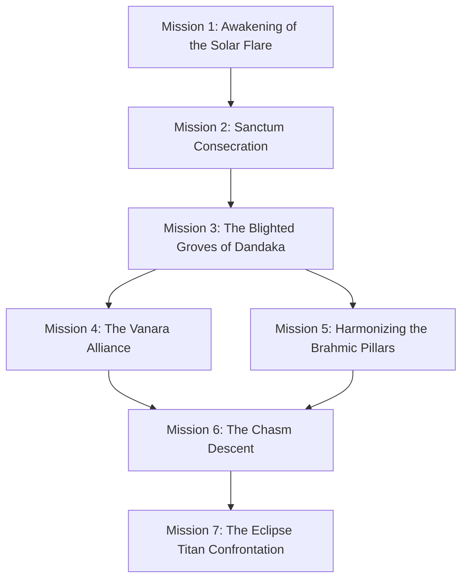

# Mythos: Astra & The Seven Realms — Narrative Architecture & Campaign Screenplay

**Document Version:** 1.0.0-PROD  
**Classification:** Canonical Story Bible, Mission Architecture & Cinematic Screenplay  
**Chapter Scope:** Chapter I — *The Dawning Flare of Dandaka*  
**Engine Compatibility:** Stage 5 Production Narrative & Quest Subsystem  

---

## 1. Executive Narrative Vision

### 1.1 The Core Theme: Dharma in an Age of Entropy
*Mythos: Astra & The Seven Realms* explores the struggle of **Dharma** (cosmic righteousness, order, and spiritual purpose) against **Tamas** (entropy, inertia, despair, and corruption) at the dusk of the Dvapara Yuga. 

The story is not a simplistic battle of good versus evil; it is a profound examination of duty, destiny, sacrifice, and the price of cosmic preservation:
- **Veer**, the Consecrated Solar Guardian, carries the Agni-Core within his gauntlet. His burden is physical and spiritual: every time he harnesses the Solar Astra, the flame tests his resolve against arrogance and wrath.
- **Devi Tara**, the Celestial Oracle of Tapoloka, perceives all timelines through the Sri Yantra. She knows that restoring the sun requires purifying ancient entities that have succumbed to sorrow rather than merely annihilating them.
- **Mahishasura**, the Titan of the Void Eclipse, was once an ascetic who sought ultimate boons to transcend death. Convinced that existence is inherently agonizing, Mahisha views Tamas as the merciful cessation of universal suffering.

---

## 2. Character Arcs, Relationships & Moral Alignment

### 2.1 Dramatis Personae

| Character | Role | Archetype | Core Motivation | Internal Conflict |
| :--- | :--- | :--- | :--- | :--- |
| **Veer** | Protagonist | Solar Guardian / Seeker | Reconnect the severed Lokas and reforge the Astra Surya | Tempered discipline vs righteous wrath when witnessing suffering |
| **Devi Tara** | Celestial Mentor | Oracle of Tapas | Guide Veer along the razor-edge of Dharma | Cosmic detachment vs empathy for mortal fragility |
| **Vanara Scout (Kapi)** | Forest Ally / Rival | Forest Sentinel | Defend the Dandaka Grove from invaders of all realms | Ancient distrust of celestial beings vs duty to protect flora |
| **Stone Rakshasa (Sthula)** | Guardian / Tragic Adversary | Earth Construct | Guard the sacred Brahmic Pillars as ordained by Brahma | Tamasic corruption blinding his duty into mindless hostility |
| **Mahishasura** | Chapter Boss / Titan | Avatar of Tamas | Plunge the Seven Realms into eternal, painless void | Believes his entropic conquest is an act of universal mercy |

### 2.2 Relationship Affinity System (Moral Dynamics)
The narrative engine tracks three distinct relationship vectors:
1. **Tara Affinity (`tara_affinity`):** Reflects alignment with meditative wisdom, patience, and non-violence. Unlocks celestial astral blessings.
2. **Vanara Trust (`vanara_trust`):** Reflects respect for natural ecology, restraint in forest combat, and cultural empathy. Unlocks Vanara reconnaissance aid.
3. **Karmic Balance (`karmic_balance`):** Tracks moral choices between *Merciful Purification* (high difficulty, high reward) and *Wrathful Destruction* (brute force, faster progress).

---

## 3. Chapter I Screenplay: The Dawning Flare of Dandaka

### Act I: The Awakening at Surya-Kund
- **Scene 1.1 — Prologue:** Veer awakens in the Sunken Sanctum. Devi Tara’s astral projection materializes from lotus petals.
  - *Dialogue Choice 1:*
    - Option A: *"Tell me of the Astra Surya. How did Mahishasura break the sun?"* (Lore / Tara Affinity +1)
    - Option B: *"Give me a weapon and a direction. I will tear him down."* (Wrathful / Combat Buff +10% Damage)
    - Option C: *"Is there any hope left for the mortal realm?"* (Empathetic / Karmic Balance +1)
- **Scene 1.2 — The First Trial:** Veer gathers the 3 shattered shards in the Sanctum and confronts the corrupted Sentinels.
- **Scene 1.3 — The Gateway Consecration:** Attuning the Sun Altar reveals the path to Dandaka Forest.

### Act II: The Shadows of Dandaka Valley
- **Scene 2.1 — The Forest Causeway:** Veer reaches the ancient Torana Gate. Corrupted Tamas spires have blighted the Sacred Banyan Tree.
- **Scene 2.2 — The Vanara Standoff:** Vanara Scout Kapi ambushes Veer, believing Veer is an agent of Tamas.
  - *Dialogue Choice 2:*
    - Option A: [Lower Weapons] *"I bear the sacred Agni-Core. I come to cleanse the groves, not claim them."* (Vanara Trust +2)
    - Option B: [Defensive Stance] *"Stand aside, forest dweller, or face the solar fire."* (Neutral / Intimidation)
    - Option C: [Offer Amrita] *"Take this healing nectar. Your tribe suffers under the void mist."* (Vanara Trust +3, Karmic Balance +1)
- **Scene 2.3 — The Dual Pillars:** Veer harmonizes the Sanskrit Brahmic Pillars (ॐ / क्रीं), lifting the void barrier over the Chasm.

### Act III: The Obsidian Throne
- **Scene 3.1 — The Ravine Crossing:** Veer crosses the volcanic suspension bridge into the subterranean caldera.
- **Scene 3.2 — Mahishasura’s Manifesto:** Mahisha manifests in his titanic buffalo silhouette above the molten fissures.
  - *Dialogue Choice 3:*
    - Option A: *"Your void is not mercy—it is the cowardice of those who fear to shine."* (Dharma Stance / Unlocks Solar Resonant Surge)
    - Option B: *"Surrender the Core, Mahisha, or be reduced to ash."* (Warrior Stance / Unlocks Heavy Stagger Thrust)
- **Scene 3.3 — The Climactic Battle:** Three-phase confrontation against Mahishasura and his Elite Vanguard.
- **Scene 3.4 — Epilogue & Horizon:** Cleansing the throne room restores dawn over Dandaka Valley and unlocks the gateway to the Floating Citadels of Vayu.

---

## 4. Mission Graph & Dependency Architecture



---

## 5. Quest System Technical Specifications

### 5.1 Objective Types
1. `EXPLORE_LOCATION`: Reach coordinate radius $[x, y, r]$.
2. `COLLECT_SHARD`: Accumulate $N$ purified Astra fragments.
3. `DEFEAT_TARGET`: Vanquish specific enemy archetype or boss tag.
4. `INTERACT_NPC`: Engage in dialogue with key NPCs (Tara, Kapi).
5. `CONSECRATE_ALTAR`: Complete sacred prop activation ritual.
6. `CHOOSE_DIALOGUE`: Resolve branching moral fork.

### 5.2 Versioned Save State Schema Contract (`v2.0.0`)
```typescript
export interface NarrativeSaveState {
  version: '2.0.0';
  timestamp: number;
  activeMissionId: string;
  completedMissionIds: string[];
  objectiveProgress: Record<string, number>;
  storyFlags: Record<string, boolean | number | string>;
  relationships: {
    taraAffinity: number;
    vanaraTrust: number;
    karmicBalance: number;
  };
  dialogueHistory: string[];
  unlockedCutscenes: string[];
  checksum: string;
}
```
