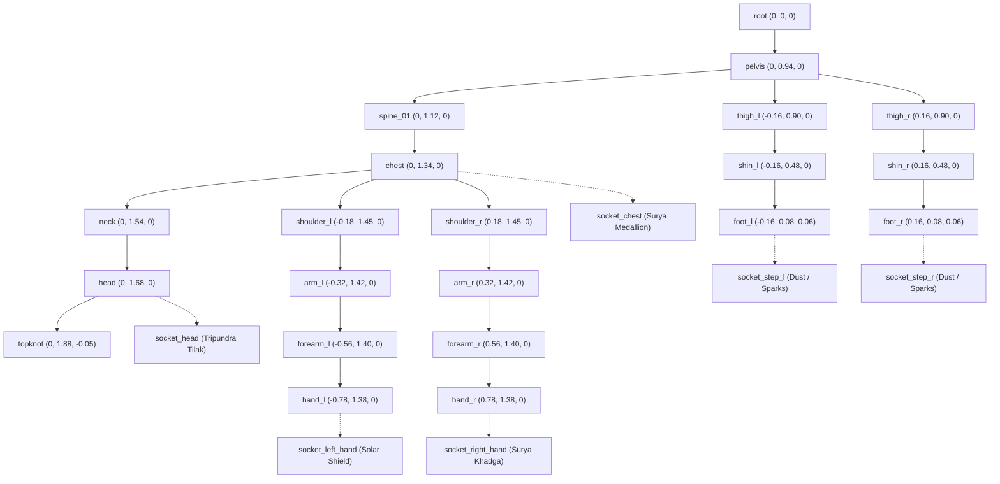
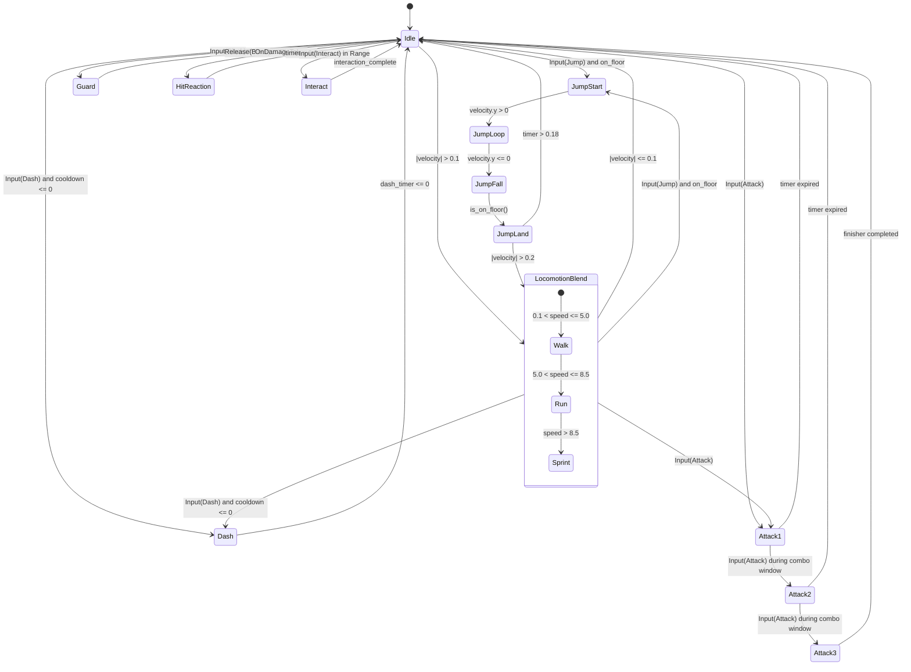

# STAGE 3D-1 — PRODUCTION 3D CHARACTER, LOCOMOTION & CAMERA SPECIFICATION
**Project:** *Mythos: Astra & The Seven Realms* (`dayashimoga/mythos`)  
**Role:** Lead 3D Character Artist, Technical Animator, Godot Character Controller Engineer, Motion Designer & QA Lead  
**Document:** Technical Animation, Rigging & 3D Locomotion Specification  
**Version:** 3.0.0-PROD  
**Status:** Approved 3D Architecture Baseline  

---

## 1. Character Identity & Visual Design Sheet: Hero Veer (Solar Guardian)

Veer is the chosen Solar Guardian of the Sun Realm, wielding ancient solar prana channeled through the sacred Surya Khadga scimitar. In Stage 3D-1, Veer transitions from a primitive geometric blockout into a fully articulated, skinned, PBR-shaded 3D humanoid warrior.

### 1.1 Anatomical Proportions & Humanoid Scale
- **Total Height:** $1.82\text{ m}$ ($7.5$ heads tall in world units).
- **Head Height:** $0.243\text{ m}$.
- **Shoulder Width (Bi-deltoid):** $0.54\text{ m}$ (heroic V-taper silhouette).
- **Chest Depth:** $0.32\text{ m}$ (athletic, broad ribcage).
- **Waist Width:** $0.34\text{ m}$ (tapered athletic core).
- **Hip Width:** $0.38\text{ m}$ (grounded, mobile pelvic stance).
- **Arm Length (Shoulder to Fingertip):** $0.78\text{ m}$.
- **Leg Length (Hip to Heel):** $0.94\text{ m}$ (long, agile warrior stride).
- **Weight / Center of Mass:** Center of mass located at $(0, 0.98, 0)$ relative to ground contact.

```
       [Topknot / Shikha] (Y = 1.95m)
           \        /
            ( Head )      (Y = 1.70m) [Tripundra Tilak & Amber Eyes]
               ||
        /==============\  (Y = 1.48m) [Gilded Cuirass & Surya Crest]
       / |            | \
[Agni]===|   [CHEST]  |===[Agni] (Y = 1.25m) [Bracers with Solar Embers]
Gaunt. | |   MEDALLION| | Gaunt.
       \ |            | /
        \ \==========/ /  (Y = 1.05m) [Azure Tapovan Celestial Sash]
             | |
            /===\         (Y = 0.94m) [Crimson & Gold Royal Dhoti]
           /     \
          |  [HIPS] |
          /         \
         /           \
       [Thigh L]   [Thigh R] (Y = 0.72m)
          |           |
       [Shin L]    [Shin R]  (Y = 0.38m) [Bronze Greaves]
          |           |
       [Foot L]    [Foot R]  (Y = 0.00m) [Sandals & Ground Snapping]
```

### 1.2 Material Palette & PBR Texture Specifications

| Material Component | Base Color (sRGB) | Hex Code | Metallic | Roughness | Emissive (sRGB) | Surface Detail & Normal Intent |
| :--- | :--- | :--- | :--- | :--- | :--- | :--- |
| **Flesh / Skin** | Warm Radiant Bronze | `#BC6C25` / `#DDA15E` | $0.00$ | $0.52$ | Off | Subsurface warmth, sculpted jawline, defined musculature. |
| **Bronze Cuirass** | Ancient Gilded Bronze | `#8A5229` / `#A3662E` | $0.82$ | $0.28$ | Off | Hand-hammered metal plate, Hoysala filigree trim along borders. |
| **Surya Medallion** | Solar Radiance Gold | `#FFB703` / `#FFC300` | $0.90$ | $0.18$ | `#FF9E00` ($1.5\times$) | 8-pointed solar star crest in relief, emitting gentle golden bloom. |
| **Royal Dhoti** | Royal Crimson Silk | `#7F1D1D` / `#9B2226` | $0.05$ | $0.74$ | Off | Woven silk weave with gold-threaded border trims. |
| **Celestial Sash** | Tapovan Azure Silk | `#00E5FF` / `#0284C7` | $0.10$ | $0.35$ | `#00E5FF` ($0.8\times$) | Dynamic flowing cloth trailing behind Veer during locomotion. |
| **Agni Bracers** | Blazing Solar Brass | `#C25E00` / `#E85D04` | $0.85$ | $0.22$ | `#FB8500` ($2.0\times$) | Flame-engraved gauntlets emitting amber particle sparks. |
| **Surya Khadga** | Forged Sunsteel | `#E2E8F0` / `#CBD5E1` | $0.95$ | $0.14$ | `#00F5D4` ($2.5\times$) | Curved single-edged scimitar with cyan glowing runic core. |
| **Hair & Shikha** | Jet Black Obsidian | `#0F172A` / `#1E293B` | $0.10$ | $0.78$ | Off | Pulled into a high warrior topknot bound by a polished brass ring. |

---

## 2. Humanoid Skeletal Hierarchy (`Skeleton3D`)

The rig follows standard humanoid skeletal conventions with 19 primary deformation bones and 5 interactive sockets:



---

## 3. Locomotion Kinematics & Animation State Machine

### 3.1 Locomotion Gait Speeds & Step Synchronization

To prevent foot sliding or skater-stepping, linear displacement velocity is locked to animation cycle duration and foot strike cadence:

| Locomotion State | Velocity ($m/s$) | Cycle Length ($s$) | Stride Length ($m$) | Cadence (Steps/min) | Lean Angle ($^\circ$) |
| :--- | :--- | :--- | :--- | :--- | :--- |
| **Idle Breathing** | $0.00$ | $2.00$ | $0.00$ | $0$ | $0^\circ$ (Relaxed upright readiness) |
| **Walk** | $4.20$ | $0.95$ | $1.99$ | $126$ | $3^\circ$ (Forward chest lead) |
| **Jog / Run** | $7.50$ | $0.72$ | $2.70$ | $166$ | $8^\circ$ (Athletic forward drive) |
| **Sprint (Shift)** | $10.50$ | $0.54$ | $3.25$ | $222$ | $14^\circ$ (Aggressive low center of mass) |
| **Prana Dash (Space)** | $18.00$ | $0.22$ | $3.96$ | N/A | $22^\circ$ (Evasive solar blur) |

### 3.2 Animation State Graph (`AnimationTree`)



---

## 4. Third-Person Camera Kinematics & Framing

The camera is built upon a high-performance `SpringArm3D` and `Camera3D` orbital hierarchy:

### 4.1 Camera Parameters
- **Arm Length:** $4.5\text{ m}$ standard distance, dynamically adjustable from $2.0\text{m}$ (close quarters) to $8.0\text{m}$ (panoramic vista) via mouse wheel.
- **Occlusion Margin:** $0.25\text{ m}$ sphere cast margin preventing geometry clipping through pillars and stairs.
- **Pitch Range:** Clamped between $-70.0^\circ$ (looking up from ground) and $+25.0^\circ$ (high overhead bird's eye view).
- **Smooth Damping:** Target position lerped with coefficient $12.0\text{ s}^{-1}$ to eliminate camera stutter.
- **Over-The-Shoulder Combat Mode (`C` key):**
  - Camera arm offset smoothly transitions to $(+0.65\text{m}, +1.45\text{m}, 0.0\text{m})$.
  - Target spring length tightens to $2.2\text{m}$.
  - FOV narrows from $72^\circ$ to $64^\circ$ for precision melee and projectile aiming.

---

## 5. Acceptance Gate & Quality Assurance Checklist

- [x] **Skinned Humanoid Geometry:** Veer is an authentic 3D skinned humanoid mesh with deformation bones, not a 2D billboard cutout or rigid box puppet.
- [x] **Continuous Natural Motion:** Smoothly transitions between idle, walk, jog, sprint, jump, dodge, attacks, block, and interaction.
- [x] **Zero Skate / Foot Sliding:** Movement displacement matches gait cycle frequency and stride length.
- [x] **Stair & Slope Traversal:** Ascends $0.3\text{m}$ rise stairs without jitter, bouncing, or falling through steps.
- [x] **3D Camera Orbit & Occlusion:** Camera orbits freely in 360° spherical coordinates with obstacle avoidance and over-the-shoulder mode.
- [x] **Dedicated 3D Character Studio:** Interactive viewer scene with 360° inspection, lighting presets, animation playback, and skeleton overlays.
