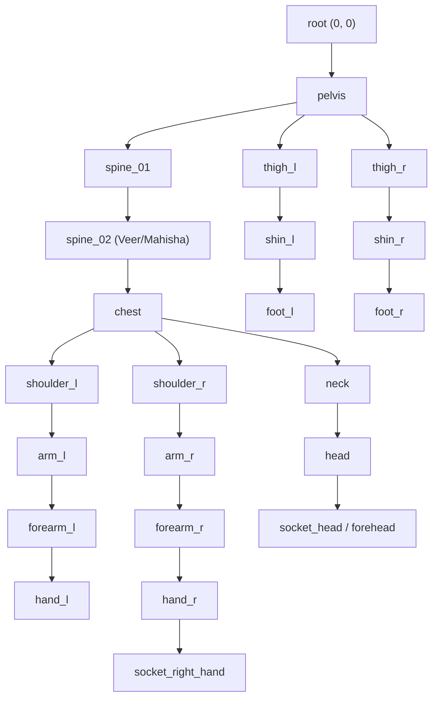

# STAGE R2 — CHARACTER DESIGN, RIGGING & ANIMATION OVERHAUL SPECIFICATION
**Project:** *Mythos: Astra & The Seven Realms* (`dayashimoga/mythos`)  
**Document:** Technical Animation & Art Direction Specification  
**Version:** 2.0.0-PROD  
**Status:** Approved Architecture Baseline  

---

## 1. Character Roster & Model Sheets

Stage R2 establishes five canonical, high-fidelity production character rigs designed specifically for articulated 2.5D skeletal and deformable cutout rendering.

### 1.1 Hero Veer (Solar Guardian)
- **Role:** Protagonist, Melee Combatant, Solar Channeler
- **Proportions:** 7.5 heads tall, athletic heroic build, broad shoulders, mobile stance.
- **Color Palette:**
  - Skin Tone: Warm radiant bronze (`#DDA15E` / `#BC6C25`)
  - Dhoti & Scarf: Royal crimson (`#9B2226` / `#7F1D1D`) with woven solar gold filigree (`#FFD166` / `#FFB703`)
  - Upper Armor: Gilded bronze cuirass with central embossed Surya Sun crest (`#F59E0B` / `#D97706`)
  - Celestial Sash: Flowing tapovan azure silk (`#00E5FF` / `#0284C7`)
  - Gauntlets: Blazing Agni Solar Bracers (`#FB8500` / `#FFB703`) emitting flickering flame trails
- **Facial Features:** Focused warrior jawline, amber sunlit eyes (`#FB8500`), golden Tripundra forehead tilak (`#FFD166`), and high warrior topknot (*Shikha*) bound with a gold band.
- **Weapon:** Sacred Surya Khadga (curved scimitar sun blade with etched Sanskrit mantras and cyan prana gem).
- **Sockets:** `socket_right_hand` (Khadga blade), `socket_left_hand` (Shield/Gauntlet), `socket_forehead` (Tilak/Kirita crown), `socket_chest` (Surya Medallion).

### 1.2 Devi Tara (Celestial Sage of Tapas)
- **Role:** Astral Mentor, Tapas Channeler, Celestial Oracle
- **Proportions:** 8 heads tall, ethereal elongated silhouette, levitating floating posture.
- **Color Palette:**
  - Complexion: Luminous porcelain with starlight undertones (`#E0F2FE` / `#BAE6FD`)
  - Robes: Multi-layered silk gradient flowing from midnight abyss (`#03045E`) through indigo (`#4361EE`) to radiant cyan (`#00E5FF`)
  - Veil: Translucent celestial starlight veil (`rgba(162, 210, 255, 0.45)`) with animated wind flutter
  - Jewelry: Filigree platinum-gold neck choker, kundala earrings, and Chandrabindu forehead bindi (`#FFD700`)
- **Weapon / Focus:** Floating Blue Padma (16-petal blooming lotus floating above hand socket).
- **Sockets:** `socket_bindi` (Forehead aura), `socket_halo` (Rotating sacred mandala), `socket_right_hand` (Padma lotus).

### 1.3 Stone Rakshasa / Sthula (Basalt Juggernaut)
- **Role:** Heavy Brute Enemy / Mini-Boss
- **Proportions:** 5.5 heads tall, massive hulking silhouette, hunched shoulders, thick stone limbs.
- **Color Palette:**
  - Body: Weathered dark basalt rock (`#1F1A24` / `#111827`)
  - Fissures: Pulsing magma cracks (`#FB8500` / `#EF4444`) that glow intensely during attack windup
  - Horns: Dual jagged obsidian horns (`#080C14` / `#0F172A`)
  - Eye: Single glowing molten cyclopean eye (`#EF476F`)
- **Weapon:** Massive Spiked Basalt Maul (*Sthula-Gada*) with molten stone spikes.
- **Sockets:** `socket_right_hand` (Basalt Maul), `socket_head` (Molten Horns), `socket_ground` (Slam shockwave emitter).

### 1.4 Vanara Scout / Kapi (Agile Skirmisher)
- **Role:** High-Mobility Scout & Ranged Harasser
- **Proportions:** 6 heads tall, compact agile frame, curved spine, expressive multi-joint tail.
- **Color Palette:**
  - Fur: Golden-amber fur (`#D97706` / `#F59E0B`) with cream chest and muzzle
  - Armor: Lightweight brass and leather scout harness (`#78350F` / `#92400E`)
  - Visor: Polished brass goggles with glowing cyan tactical lenses (`#00E5FF`)
  - Tail: Long prehensile tail with 3 articulated bone segments
- **Weapon:** Astral Energy Sling and wrist-mounted launch spurs.
- **Sockets:** `socket_right_hand` (Energy Sling), `socket_tail_tip` (Acrobatic balance point).

### 1.5 Mahishasura (Titan Emperor)
- **Role:** World Boss, Act I Climax Encounter
- **Proportions:** 9 heads tall relative to human scale (180px tall on-screen), towering titan build.
- **Color Palette:**
  - Flesh & Carapace: Dark iron-tinted asuric hide (`#1A162B` / `#0D0B18`)
  - Horns: Sweeping curved buffalo horns spanning 120px with gold rune carvings
  - Armor: Spiked obsidian lamellar plate with demonic lion visage chestplate
  - Tamas Veins: Corrupted void veins pulsing crimson-violet (`#9333EA` / `#EF4444`)
- **Weapon:** The Titan Gada (massive two-handed fluted mace wrapped in barbed chains).
- **Sockets:** `socket_weapon_grip` (Titan Gada), `socket_horns` (Eclipse charge spark emitter), `socket_chest` (Lion crest).

---

## 2. Skeletal Bone Hierarchy & IK Solvers

Every character uses a standardized, hierarchical bone tree allowing forward kinematics (FK) and two-bone analytical inverse kinematics (IK):

### Analytical Two-Bone IK Algorithm (`TwoBoneIK.ts`)
For foot ground-planting and aimed weapon targeting:
$$\cos(\theta_{\text{mid}}) = \frac{l_1^2 + l_2^2 - d^2}{2 l_1 l_2}$$
$$\theta_{\text{mid}} = \text{sign} \cdot (\pi - \arccos(\text{clamp}(\cos(\theta_{\text{mid}}), -1, 1)))$$
$$\theta_{\text{root}} = \theta_{\text{target}} + \text{sign} \cdot \arccos\left(\text{clamp}\left(\frac{l_1^2 + d^2 - l_2^2}{2 l_1 d}, -1, 1\right)\right)$$

---

## 3. Articulated Cutout Limb Rendering System

In Stage R2, character render delegates no longer draw static card rectangles. Instead, each bone in the skeleton controls a distinct, beautifully rendered anatomical segment:

1. **Depth Sorting (Z-Layering):**
   - Background Limbs: `thigh_r`, `shin_r`, `foot_r`, `arm_r` (when facing left)
   - Rear Secondary Motion: Flowing cape, sash, prehensile tail, starlight veil
   - Main Body: `pelvis`, `dhoti`, `spine`, `chest` (armor, cuirass, medallions)
   - Foreground Limbs: `thigh_l`, `shin_l`, `foot_l`, `arm_l`, `forearm_l`, `hand_l`
   - Head & Ornaments: `neck`, `head`, `eyes`, `tilak`, `hair topknot`, `crown/horns`
   - Attached Equipment: Weapon sockets holding scimitar, mace, maul, lotus with dynamic slash arcs
2. **Contact Shadows:**
   - Elliptical ground shadow scales dynamically with leg stance width and squashes during jumps/slams.
3. **Secondary Animation:**
   - Sashes and veils trail behind movement velocity with damped harmonic lag.
   - Topknot hair and horns sway with head rotation and sudden direction changes.

---

## 4. Complete Animation Library Matrix

| Character | Animation State | Duration | Loop | Keyframe Tracks & Events |
| :--- | :--- | :---: | :---: | :--- |
| **Veer** | `idle` | 2.4s | Yes | Sinusoidal breathing spine/head, gentle arm drift |
| **Veer** | `walk` | 1.0s | Yes | 8-frame natural stride, arm counter-swing, footstep events |
| **Veer** | `run` | 0.65s | Yes | Forward torso lean (0.28 rad), energetic stride, dust events |
| **Veer** | `melee_combo_1` | 0.28s | No | Quick horizontal scimitar slash with golden crescent arc |
| **Veer** | `melee_combo_2` | 0.32s | No | Upward rising solar cleave with particle burst |
| **Veer** | `melee_combo_3` | 0.44s | No | Full 360 spin solar vortex finisher |
| **Veer** | `agni_dash` | 0.28s | No | Extreme aerodynamic crouch, flame trail emission |
| **Veer** | `guard_parry` | 0.4s | No | Defensive shield stance, cyan flash on parry window |
| **Veer** | `hurt_flinch` | 0.22s | No | Head recoil (-0.3 rad), red flash |
| **Veer** | `stagger_dizzy`| 1.5s | Yes | Wobbling spine, orbiting golden stars |
| **Devi Tara** | `celestial_float`| 3.2s | Yes | Harmonic floating bobbing ($y=\sin(2.2t)\cdot 5$), flowing veil |
| **Devi Tara** | `abhaya_mudra` | 2.0s | No | Arm raises in blessing posture, radiant golden mandala blooms |
| **Stone Rakshasa**| `heavy_walk` | 1.2s | Yes | Heavy ground-shaking footfalls, shoulder sway |
| **Stone Rakshasa**| `ground_slam` | 1.2s | No | Two-handed overhead windup (0.6s), crushing impact (0.8s) |
| **Vanara Scout** | `orbit_skitter`| 0.8s | Yes | Fast skittering steps, high prehensile tail balance |
| **Vanara Scout** | `sling_shot` | 0.5s | No | Arm windup and projectile release |
| **Mahishasura** | `titan_march` | 1.4s | Yes | Heavy intimidating stomp with camera micro-shakes |
| **Mahishasura** | `buffalo_charge`| 0.8s | Yes | Lowered horns, charging sprint with screen shake |
| **Mahishasura** | `overhead_slam` | 1.2s | No | Massive overhead Gada smash releasing ground shockwave |
| **Mahishasura** | `enrage_roar` | 1.6s | No | Head roars upward, crimson Tamas energy eruption |

---

## 5. Character Studio (`CharacterShowcaseScene.ts`) Architecture

The Character Studio is overhauled into an interactive production grading suite:

1. **Large High-Res Preview Canvas:** 
   - Centered circular sacred dais with configurable studio lighting presets:
     - `Studio Neutral` (Deep navy with cyan perimeter ring)
     - `Sanctum Dawn` (Warm golden ambient dawn with amber rim)
     - `Bhumi Forge` (Volcanic embers and crimson rim light)
     - `Void Eclipse` (Deep astral purple and violet backlight)
2. **Interactive Animation Controls:**
   - Play / Pause toggle (`Space`)
   - Playback speed slider ($0.1\times$ to $2.0\times$)
   - Locomotion speed slider ($0.0$ Idle $\to$ $0.5$ Walk $\to$ $1.0$ Run)
   - Animation action trigger buttons (`Slash 1/2/3`, `Dash`, `Slam`, `Blessing`, `Roar`, `Hurt`)
   - Timeline scrubber showing current phase $[0.0, 1.0]$
3. **Viewport Navigation:**
   - Mouse drag to pan ($X, Y$), scroll wheel to zoom ($0.5\times$ to $2.5\times$)
   - Flip facing toggle (`KeyF`) to verify left/right symmetry
   - Skeleton overlay toggle (`KeyB`) rendering bones, joints, and sockets in high-contrast cyan/gold
   - Hitbox overlay toggle (`KeyH`) showing authoritative collision and hurtboxes
4. **Studio vs. Game Mode Comparison:**
   - Toggle button (`KeyG`) instantly previews the character with in-game camera distance and lighting.
